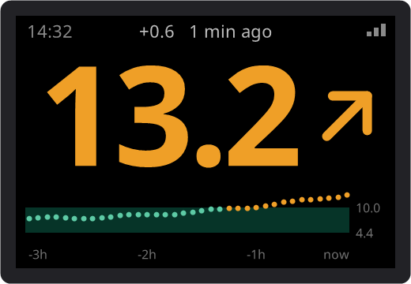
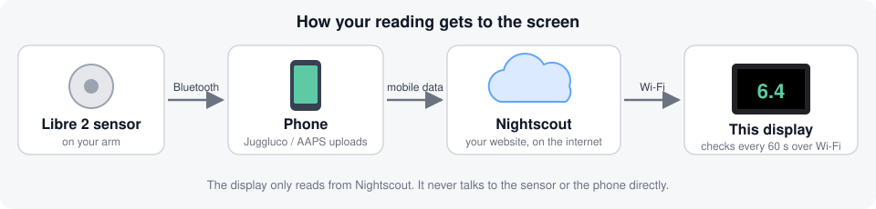
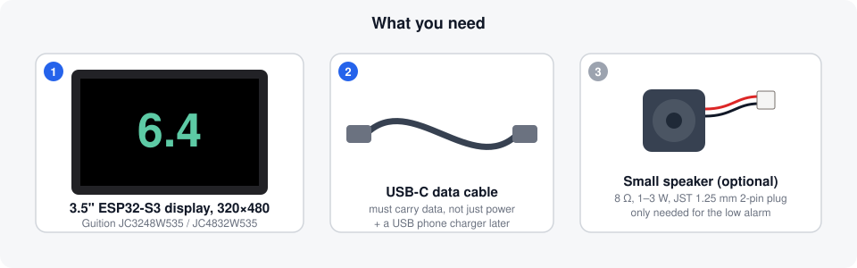
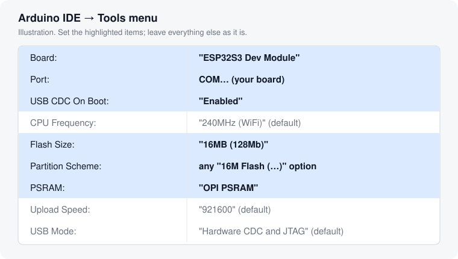
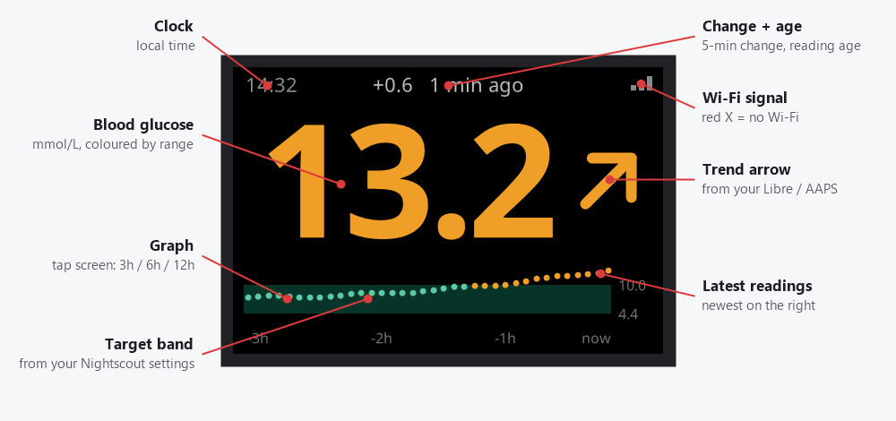

# Nightscout BG Display

A bedside / desk display that shows your blood glucose from **Nightscout** in big numbers you can read across the room. It runs on a cheap 3.5" ESP32-S3 touch screen.



**Features**

- Huge BG number in **mmol/L**, coloured using your own Nightscout ranges (green in range, amber out of range, red urgent)
- Trend arrow, 5-minute change, and how old the reading is
- Graph of the last **3 hours**. Tap the screen to switch to 6 or 12 hours
- Number **flashes** when you're below your low target or falling fast
- **Low alarm** through a small speaker. Tap to snooze
- **Night mode**: dims the screen overnight
- Greys out and crosses through the number if no new reading has arrived for 15 minutes, so an old number never looks current
- Remembers up to **3 Wi-Fi networks** (e.g. home and work) and joins whichever is in range

> ⚠️ **This is a hobby project, not a medical device.** Always rely on your CGM app and its alarms for treatment decisions.

---

## How it works



Your phone (Juggluco, xDrip+, AAPS, etc.) uploads your readings to your **Nightscout** site. The display connects to Wi-Fi and checks Nightscout every 60 seconds. You need a working Nightscout site before you start.

---

## 1. Get the hardware



### The display

Search AliExpress or Amazon for **"JC3248W535"** or **"ESP32-S3 3.5 inch 320x480 AXS15231B"**. The board is made by Guition and is sold under both names: **JC3248W535** and **JC4832W535** are the same hardware.

Check the listing says:

| Must have | Why |
|---|---|
| **ESP32-S3** | the code is for this chip |
| **3.5", 320 × 480** | the screen layout is designed for this size |
| **AXS15231B** display driver | different drivers need different code |
| **Capacitive touch** | for tap-to-snooze and switching the graph |
| **16 MB flash, 8 MB PSRAM** (often written "N16R8") | the code stores 13 hours of readings in PSRAM |

If there's a choice, pick the **version with touch** and, optionally, a **case**.

### A USB-C cable

You need a USB-C cable that carries **data**, not a charge-only cable. If your PC doesn't see the board when you plug it in, try a different cable first.

Once it's set up, any USB phone charger will power it.

### A speaker (optional)

Only needed for the low alarm. Get a small **8 Ω, 1–3 W** speaker with a **JST 1.25 mm 2-pin** plug (sometimes listed as "MX1.25" or "1.25mm 2P"). It plugs into the connector marked **SPEAK** on the back of the board. Everything else works without it.

---

## 2. Install the Arduino IDE

1. Download **Arduino IDE 2** from <https://www.arduino.cc/en/software> and install it.
2. Open it.

## 3. Add ESP32 support

1. In the Arduino IDE, click **Tools → Board → Boards Manager…** (or the board icon on the left-hand bar).
2. Search for **esp32**.
3. Install **"esp32 by Espressif Systems"**, version **3.0 or newer**.

This download is large and can take a few minutes.

## 4. Install the two libraries

1. Click **Tools → Manage Libraries…** (or the books icon on the left-hand bar).
2. Search for and install each of these:

| Library | Author | Version |
|---|---|---|
| **GFX Library for Arduino** | Moon On Our Nation | 1.5.0 or newer |
| **ArduinoJson** | Benoit Blanchon | 7.x |

> If a library install fails with **"Access is denied"**, delete the old copy of that library from `Documents\Arduino\libraries` and try again.

## 5. Download this code

1. On this GitHub page, click the green **Code** button → **Download ZIP**.
2. Unzip it.
3. Copy the **`NightscoutDisplay`** folder into your `Documents\Arduino` folder.

   The folder must be called `NightscoutDisplay` and contain `NightscoutDisplay.ino`, `config.h`, `fonts.h`, `touch.h` and `beeper.h`.
4. In the Arduino IDE, click **File → Open…** and open `NightscoutDisplay.ino`. The other files open as tabs along the top.

## 6. Enter your settings in `config.h`

Click the **`config.h`** tab and fill in:

```cpp
#define WIFI_SSID      "your-wifi-name"
#define WIFI_PASSWORD  "your-wifi-password"

#define NS_URL         "https://your-site.example.com"   // your Nightscout address, no slash at the end
#define NS_TOKEN       ""                                 // only if your site needs a token to read it
#define NS_DEVICE      "Libre2"                           // see below
#define TZ_INFO        "GMT0BST,M3.5.0/1,M10.5.0"         // UK time
```

- **Wi-Fi:** use a **2.4 GHz** network. The ESP32 can't see 5 GHz networks. You can add a second and third network in `WIFI_SSID_2` / `WIFI_SSID_3`. The display joins whichever one is in range with the strongest signal.
- **NS_TOKEN:** leave empty if you can open your Nightscout site in a browser without logging in. If you can't, create a token in Nightscout (**Admin Tools → Subjects**, role **readable**) and paste it here.
- **NS_DEVICE:** the name of the app or sensor that uploads your readings. If more than one thing uploads to your Nightscout, this picks which one to show. To find the name:
  1. Open `https://your-site/api/v1/entries.json?count=5` in a browser.
  2. Look for `"device":` in the result.
  3. Copy that value exactly (capitals included), e.g. `"Libre2"`.
- **TZ_INFO:** the time zone for the clock. A few examples are in the file.

Other options (alarm volume, snooze length, night-mode hours and brightness, etc.) are explained in the file itself. See [Settings](#settings) below.

> 🔒 **Never upload your filled-in `config.h` to GitHub.** It contains your Wi-Fi password.

## 7. Choose the board settings

Plug the display into your PC with the USB-C cable, then set these in the **Tools** menu:



| Setting | Value |
|---|---|
| **Board** | Tools → Board → esp32 → **ESP32S3 Dev Module** |
| **Port** | the COM port that appeared when you plugged the board in |
| **USB CDC On Boot** | **Enabled** |
| **Flash Size** | **16MB (128Mb)** |
| **Partition Scheme** | any option starting **16M Flash** |
| **PSRAM** | **OPI PSRAM** |

Most of these options only appear **after** you've selected *ESP32S3 Dev Module*.

> The **Flash Size** setting matters. If it's wrong (e.g. 32MB), the upload succeeds but the screen stays **blank** and the board keeps restarting.

## 8. Upload

1. Click the **→ (Upload)** button.
2. The first compile takes several minutes. Later ones are quicker.
3. When it says **"Done uploading"**, the display restarts and shows:
   1. **Connecting to Wi-Fi…**
   2. **Loading Nightscout…**
   3. your BG

If something goes wrong, open **Tools → Serial Monitor**, set the speed to **115200 baud** and press the board's reset button (**RST**). The display prints what it's doing there, including the Wi-Fi networks it can see.

---

## Using it



| What you see | Meaning |
|---|---|
| **Green** number | in your target range |
| **Amber** number | above or below your target range |
| **Red** number | urgent high or urgent low |
| **Flashing** number | below your low target, or falling fast |
| **+0.6** in the top bar | change over the last 5 minutes (mmol/L). **−** means falling |
| **1 min ago** | age of the latest reading |
| **Grey, crossed-out** number and **"No data"** | no new reading for 15 minutes or more. Check your phone and sensor |
| **zz 25m** in amber | the alarm is snoozed, 25 minutes left |
| Red **X** at top right | no Wi-Fi |

The colour ranges come from your **Nightscout settings** (Low/High and Target), so they always match your Nightscout site.

**Touch:**

- **Tap** to switch the graph between 3, 6 and 12 hours.
- **Tap during an alarm** to snooze it (30 minutes by default).

**Low alarm:** beeps at or below your Nightscout **urgent low** (3.1 mmol/L by default) and repeats every 20 seconds until you snooze it or your BG rises. The screen goes to full brightness while it's sounding. To test it without being low, set `TEST_FORCE_LOW` to `1` in `config.h`, upload, try it, then set it back to `0`.

**Night mode:** the screen dims between 22:00 and 07:00. You can change the hours and brightness in `config.h`.

---

## Settings

All in `config.h`:

| Setting | Default | What it does |
|---|---|---|
| `WIFI_SSID` / `WIFI_PASSWORD` | – | your main Wi-Fi |
| `WIFI_SSID_2`, `WIFI_SSID_3` (+ passwords) | `""` | extra networks, e.g. another building |
| `NS_URL` | – | your Nightscout address |
| `NS_TOKEN` | `""` | read token, if your site needs one |
| `NS_DEVICE` | `"Libre2"` | which uploader's readings to show (must match `"device"` in Nightscout) |
| `TZ_INFO` | UK | time zone for the clock |
| `FETCH_INTERVAL_S` | `60` | how often to check Nightscout (seconds) |
| `STALE_MINUTES` | `15` | grey out the reading after this many minutes without a new one |
| `GRAPH_HOURS_START` | `3` | graph length at start-up (3, 6 or 12) |
| `FLASH_ON_SINGLE_DOWN` | `1` | also flash on a single down arrow (`0` = double down only) |
| `ALARM_ENABLED` | `1` | `0` turns the low alarm off |
| `ALARM_VOLUME` | `60` | 0–100 |
| `ALARM_REPEAT_S` | `20` | seconds between alarm beeps |
| `SNOOZE_MINUTES` | `30` | how long a tap snoozes the alarm |
| `STARTUP_BEEP` | `1` | chirp at power-on to show the speaker works |
| `NIGHT_START_HOUR` / `NIGHT_END_HOUR` | `22` / `7` | night-mode hours |
| `DAY_BRIGHTNESS` / `NIGHT_BRIGHTNESS` | `255` / `25` | 0–255 |
| `TEST_FORCE_LOW` | `0` | `1` pretends you're at 2.8 and falling, for testing |

---

## Troubleshooting

| Problem | Fix |
|---|---|
| **Screen blank after upload**, Serial Monitor shows the board restarting over and over | **Flash Size** must be **16MB** and the **Partition Scheme** a **16M** one. Re-upload. |
| **Tools menu is missing options** like PSRAM | Select **Tools → Board → esp32 → ESP32S3 Dev Module** first. |
| **No COM port appears** | Try another USB cable (some are charge-only). If it still doesn't appear, hold **BOOT**, press and release **RST**, then release **BOOT**, and upload again. Press **RST** afterwards. |
| **Picture is upside down** | In `NightscoutDisplay.ino`, find `new Arduino_Canvas(320, 480, panel, 0, 0, 1)` and change the last `1` to `3`. |
| **Stuck on "Can't connect to your Wi-Fi"** | Check the name and password (they're case-sensitive) and that it's a **2.4 GHz** network. The Serial Monitor lists the networks the board can see. |
| **"Nightscout HTTP 401"** | Your site needs a token. Set `NS_TOKEN`. |
| **"No readings for Libre2"** | `NS_DEVICE` doesn't match your uploader. See step 6. |
| **"Loading Nightscout…" for a long time** | Free Nightscout hosting (e.g. Render) can take up to a minute to wake up. Wait, it will retry. |
| **No sound** | Check the speaker is plugged into **SPEAK** and `ALARM_ENABLED` is `1`. You should hear a chirp at start-up. |
| **Compile error: `Arduino_GFX_Library.h: No such file`** | Install **GFX Library for Arduino** (step 4). |
| **Compile error: something `was not declared`** | Make sure all five files are in the same `NightscoutDisplay` folder. |

---

## Credits

- Display library: [GFX Library for Arduino](https://github.com/moononournation/Arduino_GFX) by moononournation
- JSON: [ArduinoJson](https://arduinojson.org/) by Benoit Blanchon
- Fonts: [Noto Sans](https://fonts.google.com/noto/specimen/Noto+Sans) (SIL Open Font License), converted to anti-aliased bitmaps by `tools/make_fonts.ps1`
- Data: [Nightscout](https://nightscout.github.io/)
